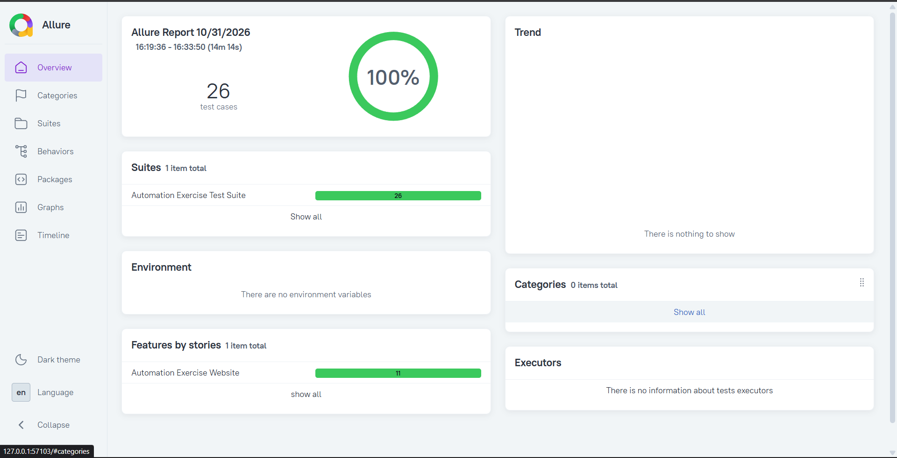

# Automation Exercise Test Automation Framework

This is my personal Selenium automation project for the website [Automation Exercise](https://www.automationexercise.com/).

I built this framework to practice real-world test automation using Java, Selenium, TestNG, Page Object Model, and Allure Report.

---

## Tech Stack

- Java 25
- Selenium WebDriver
- TestNG
- Maven
- Page Object Model (POM)
- Allure Report
- Selenium Manager (resolves the browser driver automatically — no manual driver download)

---

## Project Structure

```
src/
├── main/java/
│   ├── BrowserManager/     → Browser setup
│   ├── MyFrameWork/        → Reusable methods
│   ├── Pages/              → Page classes
│   ├── Utilities/          → Constants and helpers
│   └── Listeners/          → TestNG listener (screenshot on failure)
├── test/java/
│   └── Tests/              → Test classes
└── docs/                   → Report screenshot and test design document
```

---

## Features

- Clean Page Object Model design
- Reusable methods for common actions (click, type, wait, hover, etc.)
- Explicit waits
- Configurable browsers: Chrome, Edge, Firefox, and Brave (Brave verified end-to-end)
- All test data stored in a Constants class (no hardcoding)
- Clear assertion failure messages
- Allure Report integration
- Automatic screenshots on test failure
- No driver files in the repository: Selenium Manager downloads the right driver for your installed browser version, so the suite keeps working after browser updates
- Timestamped test accounts, so the tests can be re-run against the live site without cleanup

---

## Test Cases Automated (26 Test Cases)

| #  | Test Case                                      | Status |
|----|------------------------------------------------|--------|
| 1  | Register User                                  | Done   |
| 2  | Login with correct email and password          | Done   |
| 3  | Login with incorrect email and password        | Done   |
| 4  | Logout User                                    | Done   |
| 5  | Register with existing email                   | Done   |
| 6  | Contact Us Form                                | Done   |
| 7  | Verify Test Cases Page                         | Done   |
| 8  | Verify Products and Product Details            | Done   |
| 9  | Search Product                                 | Done   |
| 10 | Subscription on Home page                      | Done   |
| 11 | Subscription on Cart page                      | Done   |
| 12 | Add Products to Cart                           | Done   |
| 13 | Verify Product Quantity in Cart                | Done   |
| 14 | Place Order: Register while Checkout           | Done   |
| 15 | Place Order: Register before Checkout          | Done   |
| 16 | Place Order: Login before Checkout             | Done   |
| 17 | Remove Products From Cart                      | Done   |
| 18 | View Category Products                         | Done   |
| 19 | View & Cart Brand Products                     | Done   |
| 20 | Search Products and Verify Cart After Login    | Done   |
| 21 | Add Review on Product                          | Done   |
| 22 | Add to Cart from Recommended Items             | Done   |
| 23 | Verify Address Details in Checkout             | Done   |
| 24 | Download Invoice after Purchase                | Done   |
| 25 | Scroll Up using Arrow button                   | Done   |
| 26 | Scroll Up without Arrow button                 | Done   |

---

## How to Run the Project

1. Clone the repository
2. Open it in IntelliJ IDEA
3. Make sure you have **JDK 25** and **Maven** installed
4. Make sure the browser in `config.properties` is installed on your machine
5. Run the tests using:

```bash
mvn clean test
```

You do **not** need to download a WebDriver. Selenium Manager checks your installed browser version and fetches the matching driver on the first run (an internet connection is needed the first time, and again after a browser update).

### Generate Allure Report

After running the tests, generate the report using:

```bash
allure serve allure-results
```

Current status: 26 of 26 tests passing, full suite runs in about 12 minutes.



---

## Brave Browser Configuration

This project supports running tests on **Brave browser**.

To use Brave:

1. Make sure Brave is installed on your machine.
2. Open the file `config.properties`
3. Set the browser name:

```properties
browserName=brave
```

The framework launches Brave through ChromeDriver. Selenium Manager uses the Brave installation path set in `BrowserManager.java`, so that path must match where Brave is installed on your machine:

```java
options.setBinary("C:\\Program Files\\BraveSoftware\\Brave-Browser\\Application\\brave.exe");
```

If Brave is installed somewhere else, change that line, or set `browserName` to `chrome`, `edge`, or `firefox` to use another browser. (Only `brave` has been run against the full suite.)

---

## Test Design

The registration form is documented as a manual test design artifact: 38 test
cases built with equivalence partitioning, boundary value analysis, a decision
table and state transitions, plus the HTML evidence that decides which inputs are
worth testing at all.

[docs/test-design.md](docs/test-design.md)

---

## Known limitations

- Tests run against the live public site, so results depend on the internet and on the site staying unchanged.
- Only Brave has been run against the full suite; the other browsers are configured but not verified.
- The suite takes about 12 minutes because each test starts its own browser session.

---

## Author

**Omar Monir**
Junior QA Automation Engineer

- GitHub: [Omar-Monir](https://github.com/Omar-Monir)
- LinkedIn: [omar-monir](https://linkedin.com/in/omar-monir-7191722b0)
- Email: omonir446@gmail.com